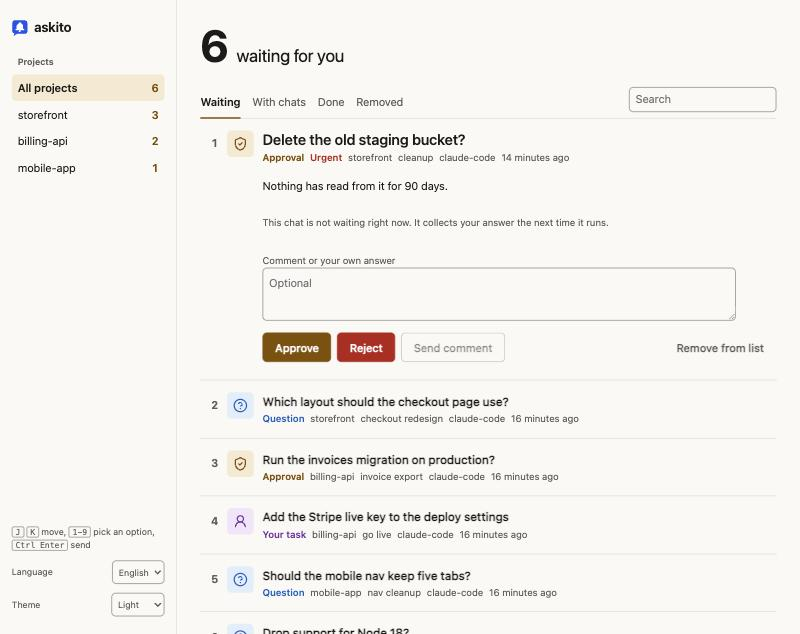

# askito

One local inbox for every question your AI coding chats need to ask you.

When you run several chats at once, each one stops at a different moment to ask something, and you end up clicking through tabs to find who is blocked. With askito, chats post their questions, approvals and human-only jobs to one page, sorted by project. You answer there, and the chat that asked carries on.



## Install

```bash
npx -y github:mahmut-polat/askito setup
```

Or paste this into any AI coding tool:

```text
Read https://raw.githubusercontent.com/mahmut-polat/askito/main/INSTALL.md and follow it.
```

Setup needs Node 20 or newer and git, and works the same on macOS, Linux and Windows. It copies askito to `~/.askito`, finds the AI tools on your machine and connects each one. Restart open chats afterwards, then open the inbox:

| System | Command |
|---|---|
| macOS, Linux | `~/.askito/bin/askito open` |
| Windows PowerShell | `& "$env:USERPROFILE\.askito\bin\askito.cmd" open` |
| Windows Command Prompt | `"%USERPROFILE%\.askito\bin\askito.cmd" open` |

The rest of this page writes the command as `askito`. Use the full path from this table.

In Claude Code, typing `/askito` opens it too. The page lives at `http://askito.localhost:4517`, which needs no DNS change or admin rights. After the first `askito open` you can type that address in your browser or bookmark it. The server starts by itself the first time a chat posts, or when you run `askito open`.

Add `--dry-run` to see which files setup would touch, or `--tools claude,cursor` to choose. Setup copies each config file to `~/.askito/backups` before its first change, and it leaves alone any JSON file it cannot fully parse (it prints what to add by hand).

There is nothing else to configure. Setup installs the skill that teaches agents how to post, and adds a rule telling every connected agent to send all questions to the inbox and stay away from chat question tools. To go back to asking in chat, delete the block between `<!-- askito:start -->` and `<!-- askito:end -->` in that tool's rules file.

A repository shows under its folder name. To rename it in the inbox, run `askito alias "Friendly name" /path/to/repo`.

## What you can do on the page

Chats post three kinds of item:

| Kind | Your controls |
|---|---|
| Question | Pick an option, or type your own answer |
| Approval | Approve, Reject, or send a comment |
| Your task | I did it, I can't do this, or send a comment |

Any item can be removed from the list, which also tells a waiting chat to drop the subject. Items move through four tabs: Waiting, With chats, Done and Removed. You can reopen anything. The sidebar splits everything by project and counts what is waiting in each.

Rows are numbered, and each has its own icon and color for its kind, so a question and a job for you look different at a glance. Each open item says whether its chat is waiting right now or will collect your answer the next time it runs. New items raise a desktop notification and update the tab title. The page comes in English and Turkish, in light and dark. To add a language, drop a file in `web/i18n` and add one line each in `web/app.js` and `src/server.js`.

Keyboard: `J` and `K` move, `1` to `9` pick an option, `Ctrl+Enter` or `Cmd+Enter` sends from the comment box.

## How an answer reaches the chat

Coding tools can't be woken from the outside, so each chat has to be listening. askito gives it three ways to do that, and the installed instructions tell the agent to use the first one its tool supports:

| Tool can | Agent does |
|---|---|
| Run a background command and wake when it exits (Claude Code) | Runs `askito ask ... --wait` in the background and keeps working |
| Call MCP tools | Calls `askito_ask`, then repeats `askito_wait` in rounds short enough for the client's tool timeout |
| Only run foreground commands | Repeats `askito wait ID --timeout 100` |

If the chat has already ended, your answer stays in the inbox. The next session in that repository runs `askito pickup`, finds it, and acts on it.

## Supported tools

| Tool | Setup writes |
|---|---|
| Claude Code | MCP server, skill, `~/.claude/CLAUDE.md` block |
| OpenAI Codex | MCP server, skill, `~/.codex/AGENTS.md` block |
| Gemini CLI | MCP server, skill, `~/.gemini/GEMINI.md` block |
| Cursor | MCP server, skill |
| Windsurf | MCP server, skill, global rules block |
| VS Code Copilot | MCP server |
| GitHub Copilot CLI | MCP server |
| Cline | MCP server |
| Roo Code | MCP server |
| Kiro | MCP server, steering file |
| Zed | MCP server |

Any other tool with a shell works through the command line. Run `askito instructions` and paste the output into that tool's rules file. A skill also lands in `~/.agents/skills` for tools that read that folder.

To skip permission prompts in Claude Code, allow `mcp__askito` and `Bash(~/.askito/bin/askito:*)` yourself. Setup never changes a tool's permission settings.

The test suite runs on macOS, Linux and Windows with Node 20, 22 and 24. Desktop notifications and opening the browser sit outside those tests and have only been tried by hand on macOS, so reports from Windows and Linux are welcome.

## Command line

```text
askito ask "Title"       --body TEXT --option "Label::Description" --recommend 1 --wait
askito approve "Title"   --body TEXT --urgent --wait
askito task "Title"      --body TEXT --chat "short name" --wait
askito wait ID           --timeout 100
askito pickup
askito reply ID "Follow-up, puts the item back in Waiting"
askito done ID "What happened"
askito list --status open
askito alias "Friendly name" /path/to/repo
```

`--wait` and `wait` exit with 0 when answered, 3 when you removed the item, and 4 on timeout. Projects come from the git repository, and every worktree of a repository lands in the same project. Run `askito --help` for the rest.

## Security and privacy

Everything stays on your machine, in `~/.askito`. There is no account, telemetry or cloud service.

The server listens on `127.0.0.1` only. It refuses unknown `Host` headers, which blocks DNS rebinding, and refuses browser posts from any other origin. Agents and the browser use separate secrets, and the answer routes accept only the browser's, so an agent calling the API cannot approve its own request. Everything an agent writes is rendered as text under a strict content security policy.

An agent running as your OS user can still read the browser secret from disk. These protections stop accidents and misuse from web pages. They do not sandbox a hostile program on your own account.

## Uninstall

```bash
~/.askito/bin/askito uninstall
```

This removes the MCP entries, skills and rule blocks, and keeps your inbox data. Add `--purge` to delete that too.

## Development

```bash
npm test
```

## License

MIT
