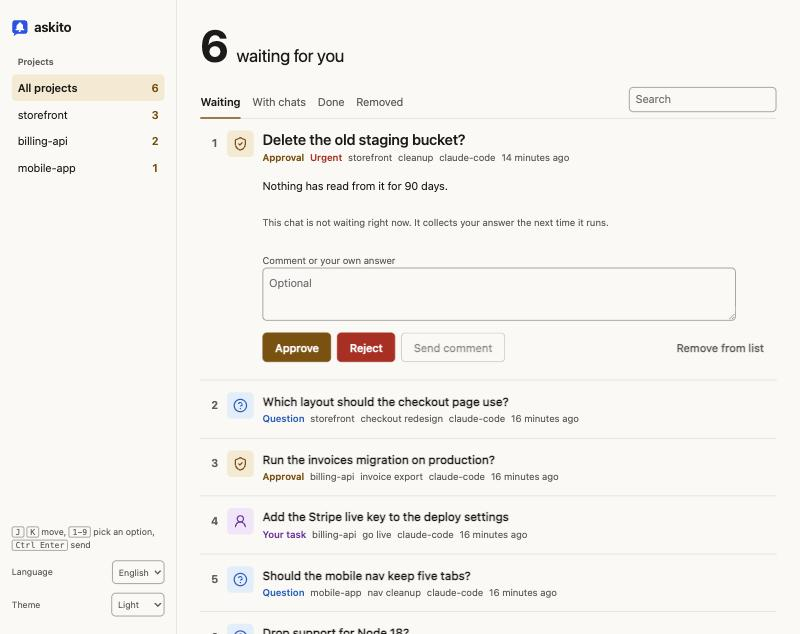

# Ask·ito

One local inbox for every question your AI coding chats need to ask you.

When you run several chats at once, each one stops at a different moment to ask something, and you end up clicking through tabs to find who is blocked. With askito, chats post their questions, approvals and human-only jobs to one page, sorted by project. You answer there, and the chat that asked carries on.



## Install

```bash
npx -y github:mahmut-polat/askito setup
```

Or paste this into any AI coding tool:

```text
I run too many AI chats at once, and each one stops in its own tab to ask me something. Install askito, a local inbox where every chat posts its questions, approvals and jobs for me, so I can answer them all from one page and each chat carries on by itself. It runs only on this machine. Read https://raw.githubusercontent.com/mahmut-polat/askito/main/INSTALL.md and follow it.
```

Setup needs Node 20 or newer and git, and works the same on macOS, Linux and Windows. It copies askito to `~/.askito`, finds the AI tools on your machine and connects each one. Restart open chats afterwards, then open the inbox:

| System | Command |
|---|---|
| macOS, Linux | `~/.askito/bin/askito open` |
| Windows PowerShell | `& "$env:USERPROFILE\.askito\bin\askito.cmd" open` |
| Windows Command Prompt | `"%USERPROFILE%\.askito\bin\askito.cmd" open` |

The rest of this page writes the command as `askito`. Use the full path from this table.

In Claude Code, typing `/askito` opens it too. The page lives at `http://askito.localhost:4517`, which needs no DNS change or admin rights. After the first `askito open` you can type that address in your browser or bookmark it. The server starts by itself the first time a chat posts, or when you run `askito open`.

If the setup output ends with lines that start with `SKIPPED Claude panel`, the panel beside the chat was not added. The inbox still works, and [Claude Code panel](#claude-code-panel) explains how to add the panel by hand on each system.

Add `--dry-run` to see which files setup would touch, or `--tools claude,cursor` to choose. Setup copies each config file to `~/.askito/backups` before its first change, and it leaves alone any JSON file it cannot fully parse (it prints what to add by hand).

The first item in a new inbox asks whether to tell the chats you already have open. Approve it and the next chat that collects the answer messages every other running session, in tools that can reach other sessions such as Claude Code. Elsewhere, restart those chats.

There is nothing else to configure. Setup installs the skill that teaches agents how to post, and adds a rule telling every connected agent to send all questions to the inbox and stay away from chat question tools. To go back to asking in chat, delete the block between `<!-- askito:start -->` and `<!-- askito:end -->` in that tool's rules file.

A repository shows under its folder name. To rename it in the inbox, run `askito alias "Friendly name" /path/to/repo`.

## What you can do on the page

Chats post three kinds of item:

| Kind | Your controls |
|---|---|
| Question | Pick an option, or type your own answer |
| Approval | Approve, Reject, or send a comment |
| Your task | I did it, I can't do this, or send a comment |

The Links tab keeps every page your chats published for you, such as artifacts, reports and previews. Click a title to open it in a new tab. In Claude Code a hook adds each published artifact by itself, and other tools add theirs with `askito link`. The same address published again updates its row, so the list does not fill with copies. Files your chats make on this computer, such as videos, PDFs and reports, go to the Files tab the same way (`askito link "Title" ~/path/to/file`). There, Open starts the file in its usual app and Show in folder opens Finder or Explorer at it. Scripts and apps are only ever shown in their folder, and only the inbox page can ask for a file to be opened.

Any item can be removed from the list, which also tells a waiting chat to drop the subject. Later takes an item off your Waiting list without closing it: the chat keeps waiting and the Later tab holds the item until you bring it back. Items move through five tabs: Waiting, Later, With chats, Done and Removed. You can reopen anything. The sidebar splits everything by project and counts what is waiting in each, and every row carries its project as a colored badge.

Answered items show whether the chat received the answer, what it is doing and what came of it, with a timeline on each item. A chat that goes quiet for 30 minutes is flagged. In Claude Code, a hook keeps a chat from ending its turn while it owes a report on an answer. Every row shows the date and time it was asked, and the list is grouped by project and then by day, newest first unless you pick another sort. Nothing opens until you open it. If a chat has gone away, its answer is offered to any other chat working in that project, which can take it over, so work does not get stuck. You can also assign an item to a specific chat, move it to another project, and map one project name onto another under Map projects. Each row has its own icon and color for its kind, so a question and a job for you look different at a glance. Each open item says whether its chat is waiting right now or will collect your answer the next time it runs. New items update the tab title. With the page open, a browser notification appears after you turn it on in the sidebar. Linux and Windows also get a desktop notification from the server. The page opens in English and also comes in Turkish, in light and dark. It does not follow the browser's language; pick one under Page language. Separately, Chats write questions in sets the language your chats use for titles, explanations and notes. It is saved on this computer, reaches open Claude Code chats with their next message, and updates the rules file of every connected tool. The same setting is `askito language tr` on the command line. To add a language, drop a file in `web/i18n` and add one line each in `web/app.js` and `src/server.js`.

Keyboard: `J` and `K` move, `1` to `9` pick an option, `Ctrl+Enter` or `Cmd+Enter` sends from the comment box.

### Finding an item a chat mentions

Every item gets a number when it is posted, counted up from 1, and the inbox shows it on the row as `#42`. The installed rule tells agents to mention an item in the chat only with the line askito prints when they post it:

```text
askito #42 "Which database should the reports use?" http://askito.localhost:4517/#42
```

There are four ways to get to it from there:

| Where | What to do |
|---|---|
| The chat | Click the link. The inbox opens on that item. |
| The inbox page | Type `42` or `#42` in the search box and press Enter. |
| The Claude Code panel | Type `/askito-panel 42` in the chat, or type `42` in the panel's search box and press Enter. |
| A terminal | Run `askito open 42`. |

Items posted before numbers existed get theirs the first time the new version starts, in the order they were asked.

## How an answer reaches the chat

Coding tools can't be woken from the outside, so each chat has to be listening. askito gives it three ways to do that, and the installed instructions tell the agent to use the first one its tool supports:

| Tool can | Agent does |
|---|---|
| Run a background command and wake when it exits (Claude Code) | Runs `askito ask ... --wait` in the background and keeps working |
| Call MCP tools | Calls `askito_ask`, then repeats `askito_wait` in rounds short enough for the client's tool timeout |
| Only run foreground commands | Repeats `askito wait 42 --timeout 100` |

If the chat has already ended, your answer stays in the inbox. The next session in that repository runs `askito pickup`, finds it, and acts on it.

## Side panels

### Claude Code panel

Claude Code can show askito in a panel beside the chat, with the open items, a filter for each project and the answer controls. The inbox page works without it.

Setup adds the panel by itself on macOS and Linux when the `claude` command is on your PATH. A machine that has the Claude desktop app but not the Claude Code command line tool may not have that command. Setup never adds the panel on Windows. Whenever the panel is skipped, the last lines of the setup output start with `SKIPPED Claude panel` and give the two commands to run.

To add the panel by hand:

1. Check that the command line tool is there. `claude --version` should print a version. If it says the command is not found, install Claude Code's command line tool first.
2. Run the two commands for your system.

   macOS and Linux:

   ```bash
   claude plugin marketplace add ~/.askito/app
   claude plugin install askito-panel@askito
   ```

   Windows Command Prompt:

   ```bat
   claude plugin marketplace add "%USERPROFILE%\.askito\app"
   claude plugin install askito-panel@askito
   ```

   Windows PowerShell:

   ```powershell
   claude plugin marketplace add "$env:USERPROFILE\.askito\app"
   claude plugin install askito-panel@askito
   ```

3. Start a new Claude Code session. Sessions that were already open do not load the panel.

The panel then opens by itself in each new session. If you close it, type `/askito-panel` in the chat to open it again, or `/askito-panel 42` to open it on item #42. The search box above the list takes a number or words from a title. There is no command that closes it; use the close button on the panel. `askito uninstall` removes the panel too, on the same condition as setup. On Windows, or where `claude` is not on your PATH, run `claude plugin uninstall askito-panel@askito` yourself.

### Chrome side panel

For claude.ai, chatgpt.com or any other tab, there is a Chrome side panel. Chrome does not let a program install an extension, so this one takes a manual step: open `chrome://extensions`, turn on Developer mode, choose Load unpacked, and pick `~/.askito/app/extensions/chrome`. Run `askito open` once with Chrome as your browser so the panel is signed in, then click the askito icon in the toolbar.

## Supported tools

| Tool | Setup writes |
|---|---|
| Claude Code | MCP server, skill, `~/.claude/CLAUDE.md` block, hooks, panel (see [Claude Code panel](#claude-code-panel)) |
| OpenAI Codex | MCP server, skill, `~/.codex/AGENTS.md` block |
| Gemini CLI | MCP server, skill, `~/.gemini/GEMINI.md` block |
| Cursor | MCP server, skill |
| Windsurf | MCP server, skill, global rules block |
| VS Code Copilot | MCP server |
| GitHub Copilot CLI | MCP server |
| Cline | MCP server |
| Roo Code | MCP server |
| Kiro | MCP server, steering file |
| Zed | MCP server |

Any other tool with a shell works through the command line. Run `askito instructions` and paste the output into that tool's rules file. A skill also lands in `~/.agents/skills` for tools that read that folder.

In Claude Code the rule is enforced as well as written. Setup adds hooks to `~/.claude/settings.json` that refuse the chat question tools, send back a reply that ends on a question, and put the rule back into context at session start, after a compaction and on every prompt. They only act while askito can run, so a broken install never blocks a chat. The app's own permission dialogs still appear in the chat window. Other tools get the written rule only.

To skip permission prompts in Claude Code, allow `mcp__askito` and `Bash(~/.askito/bin/askito:*)` yourself. Setup never changes a tool's permission settings.

The test suite runs on macOS, Linux and Windows with Node 20, 22 and 24. Desktop notifications and opening the browser sit outside those tests and have only been tried by hand on macOS, so reports from Windows and Linux are welcome.

## Command line

```text
askito ask "Title"       --body TEXT --option "Label::Description" --recommend 1 --wait
askito approve "Title"   --body TEXT --urgent --wait
askito task "Title"      --body TEXT --chat "short name" --wait
askito wait 42          --timeout 100
askito pickup
askito reply 42 "Follow-up, puts the item back in Waiting"
askito progress 42 "What the chat is doing about the answer"
askito done 42 "What happened"
askito list --status open
askito open 42           Open the inbox on item #42 (askito open --url prints the link)
askito link "Title" URL  Add a page to the Links tab (the same URL updates it)
askito link "Title" FILE Add a file to the Files tab
askito links             List them; askito links import FILE reads a Markdown table
askito unlink ID
askito alias "Friendly name" /path/to/repo
askito language tr       The language chats write questions in (en, tr, de, fr, es, it, nl, pt)
askito login             Pair with askito.net to answer from other devices
askito logout
```

`ask`, `approve` and `task` print the item's line (`askito #42 "Title"` and its link) on stderr. Without `--wait` they print only the number on stdout, so `ID=$(askito ask "Title")` works. Commands take the number without `#`, because the shell reads `#` as the start of a comment. `--wait` and `wait` exit with 0 when answered, 3 when you removed the item, and 4 on timeout. Projects come from the git repository, and every worktree of a repository lands in the same project. Run `askito --help` for the rest.

## Online access

You can also answer from your phone or another computer through askito.net. This is optional and off until you turn it on:

```bash
askito login
```

It prints a code and opens askito.net, where you sign in and approve this computer after checking that the code matches. The device token is saved in `~/.askito/cloud.json`, readable only by your user. From then on the local server sends each new or changed item to askito.net and, every 15 seconds, collects the answers you gave there. An online answer releases the waiting chat the same way an answer in the local inbox does. If you already answered an item here, the local answer stands and the online one is dropped.

Only the item itself is sent: kind, title, body, options, project, chat name, status, answer and thread. Folder paths, session ids and keys stay on this machine. `askito status` shows whether sync is on and when it last ran. `askito logout` removes this computer and its items from your account and deletes the token. Use `--server URL` with `login` to pair with another instance of the service.

## Security and privacy

Everything stays on your machine, in `~/.askito`. There is no telemetry. Without `askito login` the app sends no request to any server.

The server listens on `127.0.0.1` only. It refuses unknown `Host` headers, which blocks DNS rebinding, and refuses browser posts from any other origin. Agents and the browser use separate secrets, and the answer routes accept only the browser's, so an agent calling the API cannot approve its own request. Everything an agent writes is rendered as text under a strict content security policy.

An agent running as your OS user can still read the browser secret from disk. These protections stop accidents and misuse from web pages. They do not sandbox a hostile program on your own account.

## Uninstall

```bash
~/.askito/bin/askito uninstall
```

This removes the MCP entries, skills and rule blocks, and keeps your inbox data. Add `--purge` to delete that too.

## Development

```bash
npm test
```

## License

MIT
